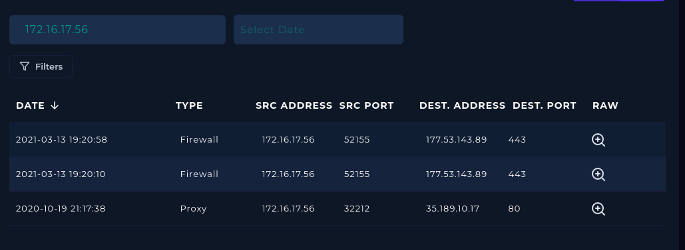
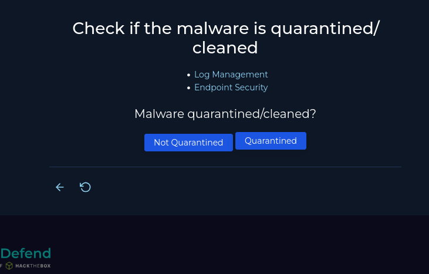
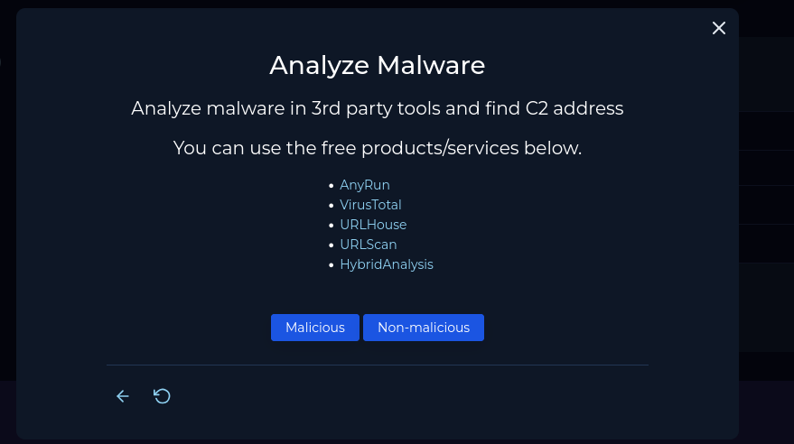
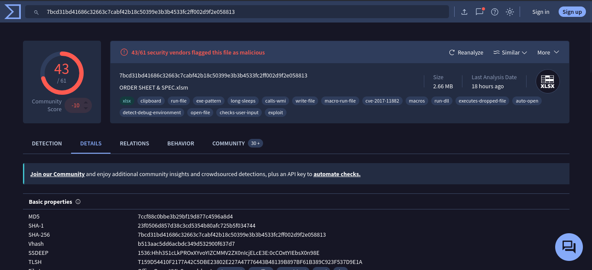
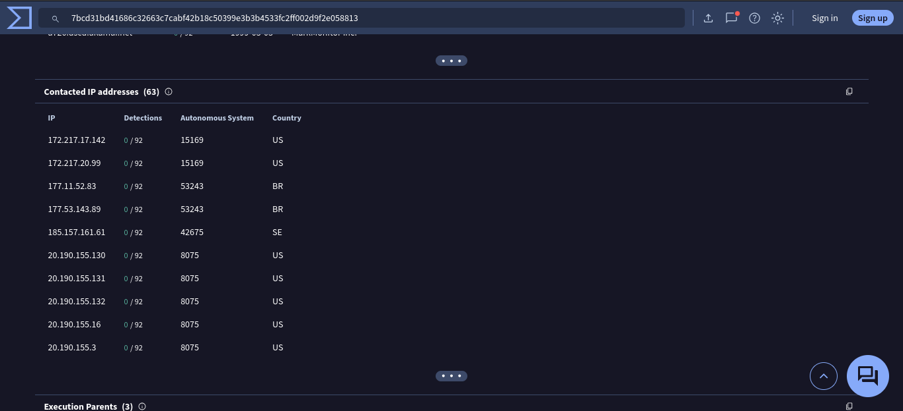
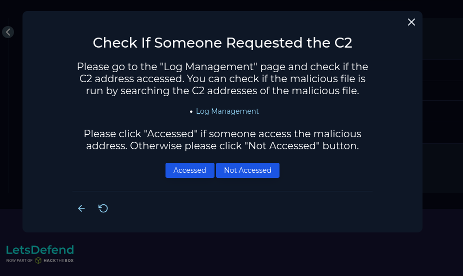
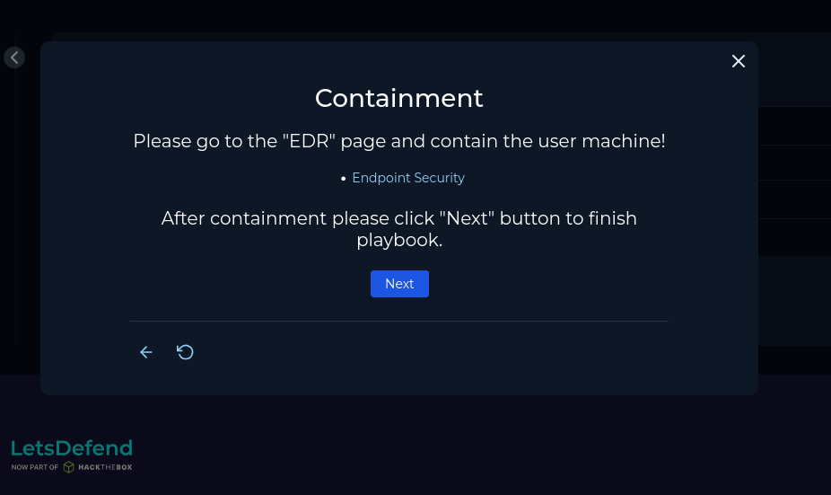
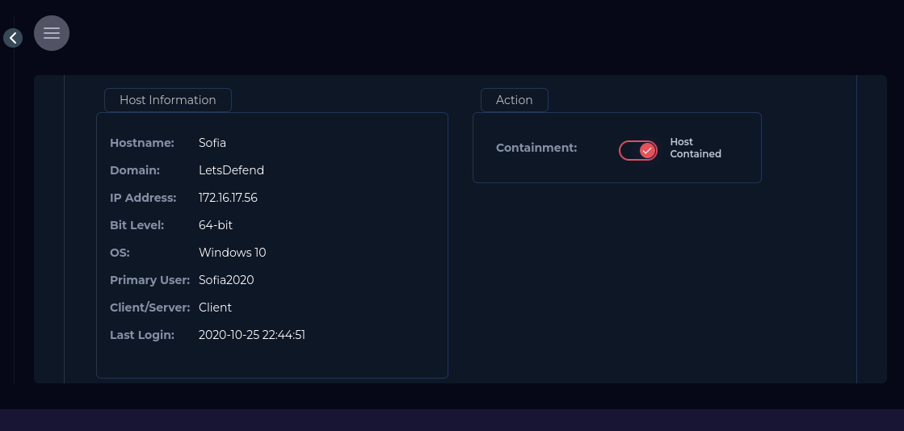

# SOC138 - Detected Suspicious Xls File

| | |
|---|---|
| **Platform** | LetsDefend |
| **Event ID** | 138 |
| **Rule** | SOC138 - Detected Suspicious Xls File |
| **Level** | Security Analyst |

## Alert Details

Let's analyze this alert to figurout what is this malware and searched for it if cleaned or not or has exploited on our device and I will use playbook to this alert.

## Define Threat Indicator 

I searched on log management to see if there any connection with the endpoint and external server or any communication with it and saw there are connection with the external IP `177.53.143.89` with our endpoint in the same date with the alert time  

So the Threat Indicator is **Unknown or Unexpected outgoing internet traffic** 

## Check if the malware is quarantined/cleaned

We know that the device action for this alert is `Allowed` so there are not antivirus or any program had blocked the file or quarantined it with this information we can say it's not quarantined

## Analyze Malware

I will searched for this file with virustotal we have the hash file `7ccf88c0bbe3b29bf19d877c4596a8d4` and his name `ORDER SHEET & SPEC.xlsm` so let's go to virustotal.

Our searched for the hash in virustotal came with result that there 43 security vendors flagged this file as malicious and it's match the name of the file and MD5 hash. after collecting these information let's search more about the file 

I went to Relation section to know which IPs that associated with this file and I saw the IP that conntact with our endpoint the country of it is `BR` stand for Brazil there alot of IP but this is the one we want 

So after known these information we can say the malware is **malicious**

## Check If Someone Requested the C2

After known these information from the past section we know that there an request from external IP and we saw the IP with the relation section in virustotal associated with the malware so we can that it's  **Accessed** to the C2 Address

## Containment

After Knowing that the malware is malicious and run on our endpoint we must contain it and isolated it from the internal network because the malware must not go to author endpoint on the internal network

## Close The Alert

Closing the alert as **True Positive**

