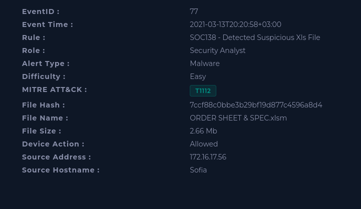
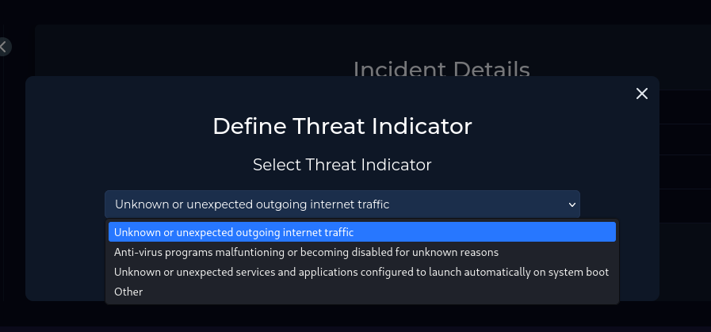

# SOC138 - Detected Suspicious Xls File

| | |
|---|---|
| **Platform** | LetsDefend |
| **Event ID** | 138 |
| **Rule** | SOC138 - Detected Suspicious Xls File |
| **Level** | Security Analyst |

## Alert Details

Let's analyze this alert to figurout what is this malware and searched for it if cleaned or not or has exploited on our device and I will use playbook to this alert.

## Define Threat Indicator 

I searched on log management to see if there any connection with the endpoint and external server or any communication with it and saw there are connection with the external IP `177.53.143.89` with our endpoint so the Threat Indicator is **Unknown or Unexpected outgoin internet traffic** 

