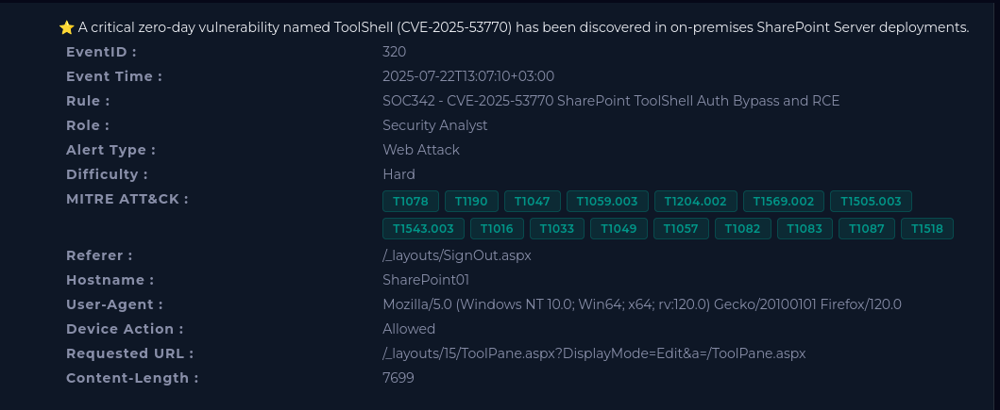
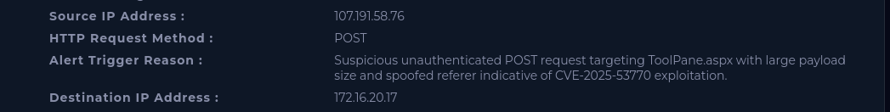
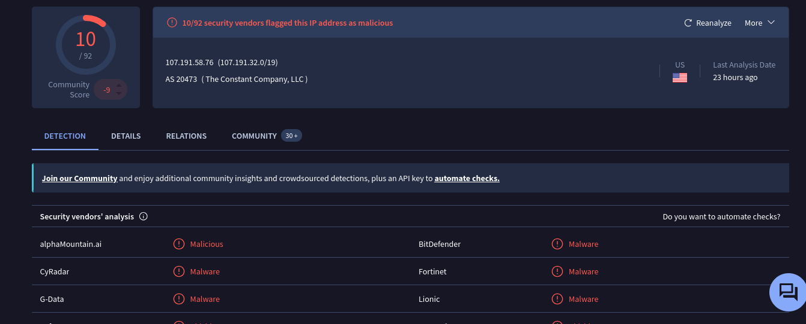
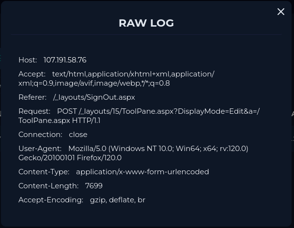
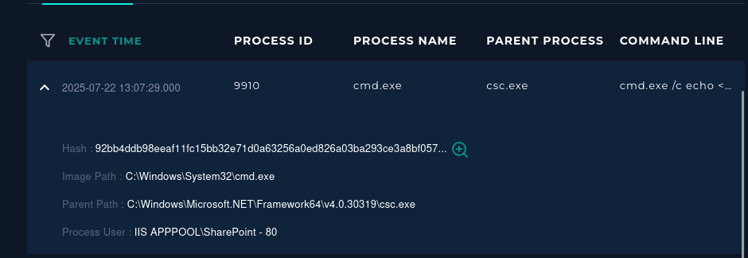
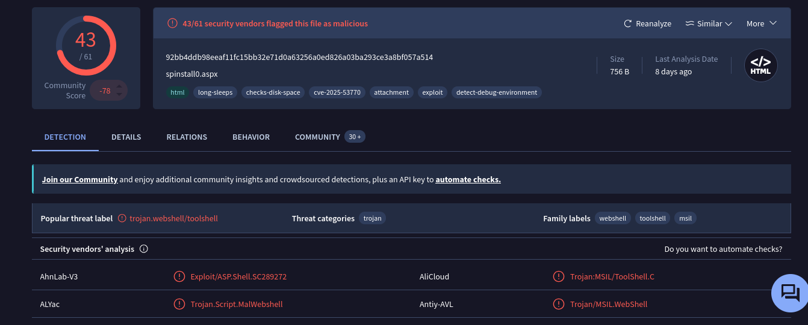
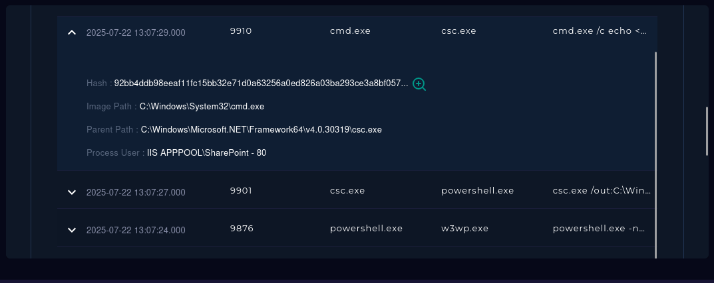

# SOC342 - CVE-2025-53770 SharePoint ToolShell Auth Bypass and RCE

| | |
|---|---|
| **Platform** | LetsDefend |
| **Event ID** | 320 |
| **Rule** | SOC342 - CVE-2025-53770 SharePoint ToolShell Auth Bypass and RCE |
| **Level** | Security Analyst |

## Alert Details




## Step 1 - Understand Why the Alert Was Triggered

The alert was triggered because the rule detected exploitation activity for **CVE-2025-53770**, a critical vulnerability (CVSS 9.8) in on-premises Microsoft SharePoint Server, known as **"ToolShell"**.

- CVE-2025-53770 is an **unsafe deserialization** flaw that leads to **Remote Code Execution (RCE)**.
- It is used together with an **authentication bypass** (related to CVE-2025-53771 / CVE-2025-49706) in an exploit chain. The chain lets an unauthenticated attacker reach the vulnerable endpoint and run code on the server.
- It affects on-premises SharePoint Server (2016, 2019, and Subscription Edition). SharePoint Online is not affected.

## Step 2 - Collect Data

**Source IP:** `107.191.58.76` (external, from the internet)

**Destination IP:** `172.16.20.17`

**Destination Host Name:** `SharePoint01`

**User-Agent:** `Mozilla/5.0 (Windows NT 10.0; Win64; x64; rv:120.0) Gecko/20100101 Firefox/120.0`



I searched for the source IP on VirusTotal, and 10 security vendors flagged it as malicious.

## Step 3 - Examine HTTP Traffic

I reviewed the logs and found that the source IP sent a `POST` request to:

```
/_layouts/15/ToolPane.aspx?DisplayMode=Edit&a=/ToolPane.aspx
```

with the `Referer` header set to `/_layouts/SignOut.aspx`.

This matches the known ToolShell exploit pattern. The spoofed `SignOut.aspx` referer is what bypasses authentication on the `ToolPane.aspx` endpoint.

The response had a content length of `7699` bytes. A large response suggests the request was processed rather than rejected, which supports the conclusion that the attacker bypassed authentication and reached the vulnerable endpoint. Response size alone is not proof of success, so it should be confirmed with the endpoint evidence in Step 5.



## Step 4 - Identify the Attack Type

The attack type is **Remote Code Execution (RCE)**, combined with an **authentication bypass**. By exploiting the server, the attacker can run arbitrary commands on the system remotely.

## Step 5 - Check Endpoint Security

I investigated the affected device and reviewed the command line, process, and terminal history. In the process history, I found a suspicious hash:



I searched for it on VirusTotal, and it was confirmed as malicious.




Before this hash appeared, `w3wp.exe` (the IIS worker process that hosts SharePoint) spawned a PowerShell process. A web server worker process launching a shell is abnormal and is the behavior expected when this CVE is exploited. In real ToolShell attacks, this step is typically used to drop a web shell (such as `spinstall0.aspx`) and steal the server's machine keys.



## Step 6 - Check Whether the Attack Was Successful

Yes, the attack was successful. The attacker exploited the vulnerability and executed commands on the server.

## Step 7 - Contain and Escalate

1. Isolate the affected device (`SharePoint01`) from the network.
2. Escalate the alert to Tier 2.
3. Close the alert as a **True Positive**.


